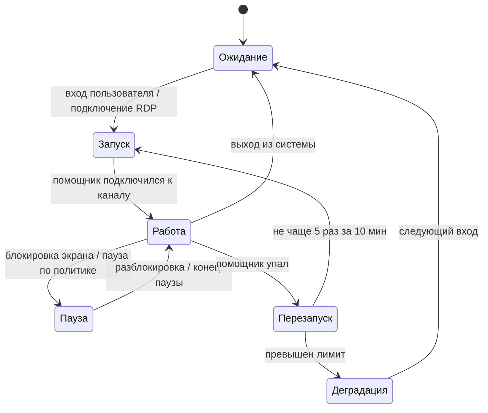

## Процессы

| Процесс | Учётная запись | Сессия | Сеть | Что делает |
|---|---|---|---|---|
| `RakursAgent` (служба) | LocalSystem | 0 | да, только к серверу | Очередь, отправка, политика, обновления, ETW, реестр, WMI, USB, сеть, запуск помощников |
| `rakurs-session.exe` | пользователь сессии | интерактивная | **нет** | Снимки, окна, простой, размытие, кодирование, трей |
| `rakurs-ui.exe` | пользователь | интерактивная | нет | Окно «Что обо мне собирается», запускается по клику |
| `rakurs-update.exe` | LocalSystem | 0 | нет (файл готовит служба) | Замена бинарников и откат |

Помощник намеренно лишён сети: даже если в нём найдут уязвимость, данные не уйдут мимо службы и её очереди.

## Жизненный цикл помощника

- Служба подписана на `SERVICE_CONTROL_SESSIONCHANGE` и при `WTS_SESSION_LOGON` или `WTS_REMOTE_CONNECT` получает токен пользователя через `WTSQueryUserToken`, создаёт блок окружения и запускает помощника `CreateProcessAsUserW` на рабочем столе `winsta0\default`.
- Помощник помещается в Job Object с ограничением CPU (`JOB_OBJECT_CPU_RATE_CONTROL`) и памяти. Если бюджет превышен, Windows сама притормозит процесс, а служба запишет событие о деградации.
- Связь — именованный канал `\\.\pipe\rakurs-<sessionId>` с ACL, разрешающим доступ только SYSTEM и владельцу сессии. Сообщения в формате protobuf с длиной в префиксе.

## Очередь {#ochered}

Очередь — SQLite-файл в `%ProgramData%\Rakurs\queue`, доступный только SYSTEM. Кадры хранятся отдельными файлами рядом, ссылка на них — в базе.

| Требование | Значение |
|---|---|
| Шифрование | AES-256-GCM, ключ данных защищён DPAPI машины (`CRYPTPROTECT_LOCAL_MACHINE`) |
| Квота по умолчанию | 2 ГБ или 5% свободного места, что меньше |
| Автономность | Не меньше 7 дней работы без сети при политике по умолчанию (FR-05) |
| Порядок вытеснения | Сначала кадры с минимальным приоритетом (интервальные), затем остальные кадры; события не вытесняются, пока занимают меньше 20% квоты |
| Гарантия доставки | Хотя бы один раз; дубликаты отсекает сервер по `(agent_id, seq)` |
| Устойчивость | Запись транзакционная (WAL), очередь переживает выключение питания |

## Окно сотрудника {#okno-sotrudnika}

Значок в трее виден всегда, пока агент активен. Его нельзя скрыть политикой. По клику открывается окно:

- **Что собирается:** перечень из действующей политики простым языком: «снимок экрана раз в 5 минут и при смене окна; список запущенных программ; время в приложениях; подключение флешек».
- **Что не собирается:** нажатия клавиш, звук, камера, личные файлы.
- **Последние снимки:** миниатюры за сегодня, ровно в том виде, в каком они ушли на сервер (с размытием).
- **Пауза:** кнопка «Личное время» с выбором 15/30/60 минут, если политика её разрешает; лимит минут в день задаёт политика. Пауза видна руководителю как интервал без данных, а не как нарушение.
- **Документы:** ссылка на положение о мониторинге и контакт ответственного.
- **Кто смотрел мои данные:** если политика это включает (`privacy.viewNotice`) — список просмотров снимков с датой и ролью смотревшего.

Состояния значка: «запись идёт», «пауза», «нет связи с сервером (данные копятся на ПК)», «агент не активирован (нет ознакомления)».

## Сбор начинается после ознакомления

Пока сервер не вернул для учётной записи флаг `acknowledged = true`, помощник не делает снимков и не собирает данные, привязанные к человеку. Служба при этом собирает только технические данные ПК (инвентаризация, состояние защиты) — они нужны ИТ независимо от мониторинга. Флаг ставит HR в консоли или синхронизация с кадровой системой после подписания уведомления (FR-09).

## Защита от вмешательства

Задача — защититься от **обычного пользователя**, а не спрятаться от администратора или антивируса.

| Мера | Как |
|---|---|
| Остановка службы | ACL службы разрешает остановку только администраторам; восстановление после сбоя — перезапуск через 10 с |
| Удаление | Через MSI с паролем удаления или токеном из консоли; событие об удалении уходит на сервер до удаления |
| Подмена файлов | Каталог `%ProgramFiles%\Rakurs` только для чтения пользователям; при старте служба проверяет подпись своих бинарников |
| Подмена политики | Политика подписана ключом сервера, неподписанная игнорируется |
| Остановка помощника | Пользователь может завершить свой процесс; служба перезапустит его и запишет событие `helper_killed` |
| Подмена времени | События несут монотонный счётчик и время сервера с последней синхронизации |

Чего агент **не делает**: не скрывает процесс и службу, не внедряется в другие процессы, не ставит драйвер ядра, не отключает антивирус, не мешает диспетчеру задач. Это и этично, и практично — такие техники делают агент неотличимым от вредоносного ПО ([R4](risks.html#r4-konflikt-s-antivirusom)).

## Журналы агента

Журнал агента — в `%ProgramData%\Rakurs\logs`, ротация по 10 МБ, 5 файлов. Персональные данные (заголовки окон, имена файлов) в журнал не пишутся. Ошибки уровня warning и выше дублируются на сервер как события `agent_health`.
