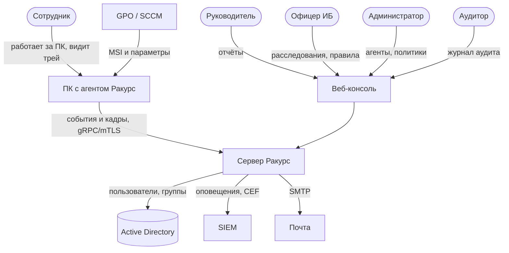
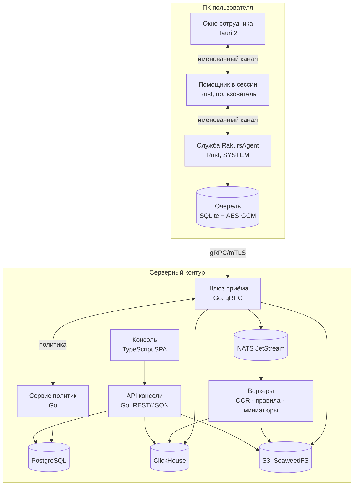
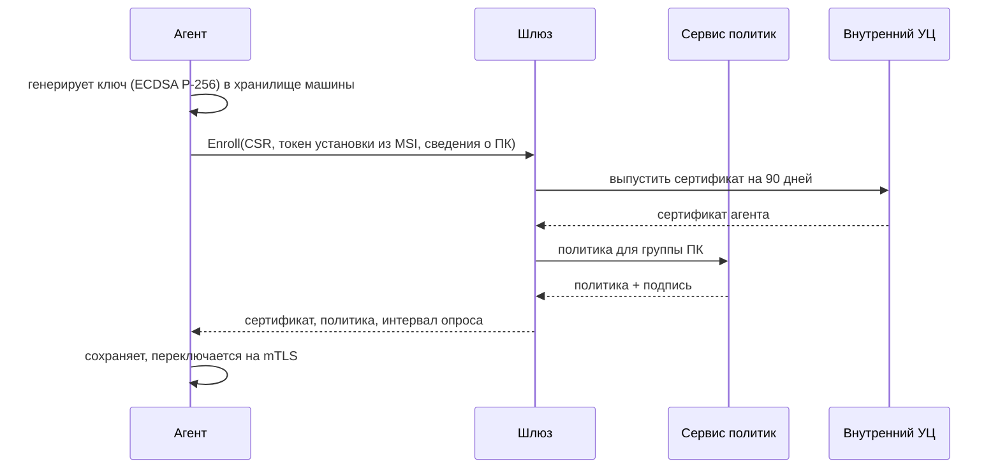
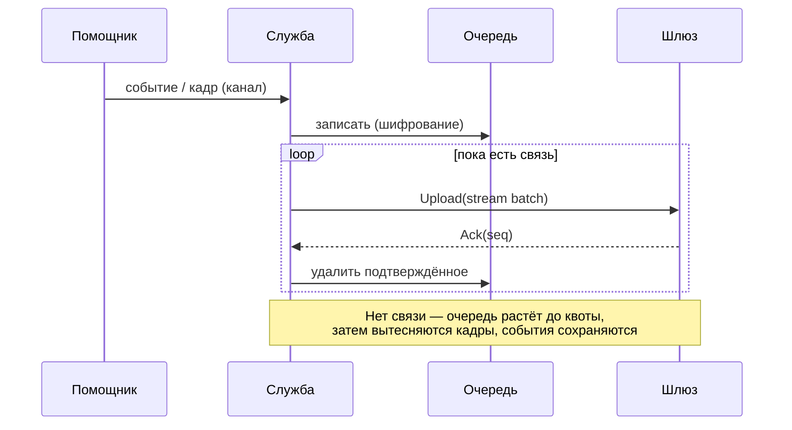
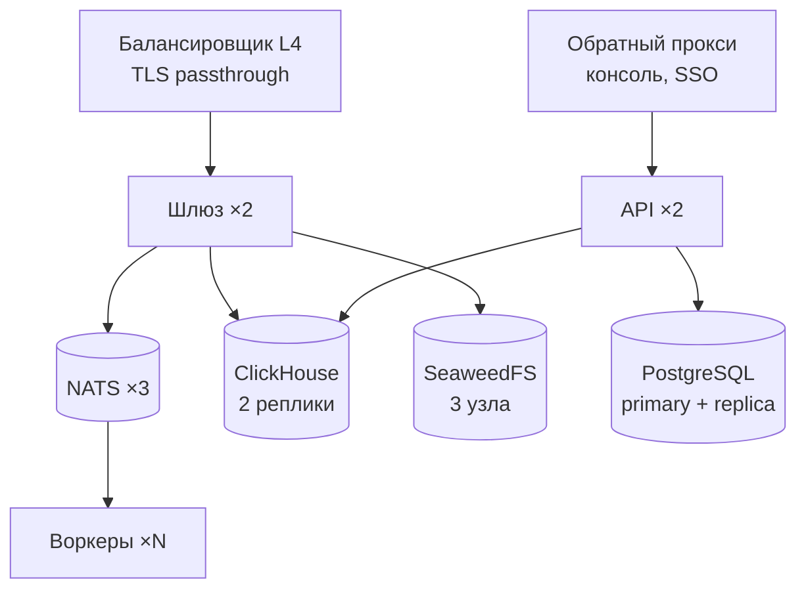

## Контекст

## Контейнеры

| Компонент | Язык | Ответственность |
|---|---|---|
| Служба `RakursAgent` | Rust | Запуск помощников, системная телеметрия (ETW, реестр, WMI, USB, сеть), очередь, сеть, обновления, применение политики |
| Помощник `rakurs-session` | Rust | Снимки, активное окно, простой, трей, размытие, кодирование кадров |
| Окно сотрудника | Tauri 2 (Rust + TS) | Перечень собираемых данных, последние снимки, пауза, контакт ответственного |
| Шлюз приёма | Go | Аутентификация агентов, приём потоков, запись в ClickHouse и S3, постановка задач |
| Сервис политик | Go | Хранение, версии, подпись и выдача политик |
| API консоли | Go | REST для консоли, RBAC, журнал аудита, выдача кадров по подписанным ссылкам |
| Воркеры | Go + ONNX Runtime | OCR, маскирование, правила и оповещения, миниатюры, удаление по сроку |
| Консоль | TypeScript, React | Интерфейс для ролей из [ТЗ](tz.html#uchastniki-i-roli) |

## Потоки данных

### Регистрация агента

Токен установки — одноразовый или групповой с ограниченным сроком, задаётся в параметрах MSI. После регистрации агент работает только по клиентскому сертификату.

### Отправка данных

## Развёртывание сервера

Для инсталляций до 200 ПК допускается одна виртуальная машина: все сервисы в Docker Compose, PostgreSQL и файловое хранилище вместо ClickHouse и S3. Размеры серверов — в [Производительности](performance.html#razmery-serverov).

## Принципы

- **Данные идут в одну сторону.** Агент инициирует все соединения. На ПК нет открытых портов.
- **Сервер не командует агентом.** Только подписанные политики и обновления ([ADR-006](adr.html#adr-006)).
- **Кадры отдельно от событий.** Событие ссылается на кадр по идентификатору; доступ к кадру проверяется отдельно и пишется в аудит.
- **Сроки хранения в данных.** У каждой записи есть класс хранения, по которому её удалит TTL ClickHouse или правило жизненного цикла S3.
