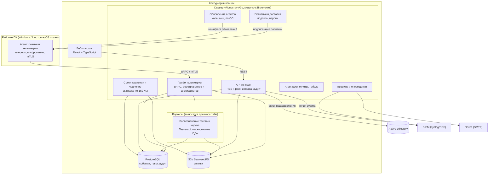
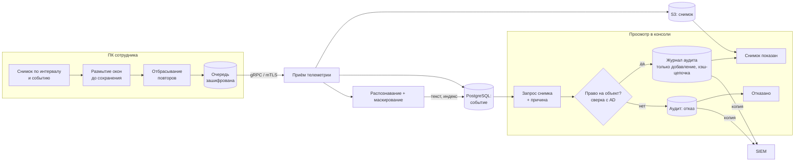

«Ясность» — это агенты на рабочих ПК, сервер в контуре организации и веб-консоль. Облачной версии нет: всё работает на вашем оборудовании. Ниже — как устроен сервер и как между частями ходят данные.

## Сервер: один бинарник, роли при развёртывании

Сервер собран как **модульный монолит** на Go. Из одного исходного дерева собирается один бинарник `yasnost-server`, который запускается в нужной роли:

```bash Роли одного бинарника
yasnost-server run --role=all         # небольшая установка: всё в одном процессе
yasnost-server run --role=gateway     # только приём телеметрии (gRPC)
yasnost-server run --role=api         # только REST API консоли
yasnost-server run --role=worker-ocr  # только распознавание текста и фоновые задачи
```

- Для установок **до 200 ПК** хватает одного процесса (`--role=all`) или одного образа, запущенного под разными ролями в `docker compose`. Внешне это те же сервисы `gateway`, `api`, `worker-ocr`, но это один и тот же бинарник с разными флагами.
- При росте парка приём телеметрии, API и OCR-воркеры **масштабируются по отдельности** — репликами того же образа, не переписывая код.

Так требование «один бинарник» и схема развёртывания из отдельных сервисов оказываются одной системой: монолит в сборке, набор ролей в развёртывании.

## Как части соединены



## Путь данных: от снимка до просмотра

Снимок готовится на самом ПК: окна из списка размытия закрываются **до** сохранения, повторы отбрасываются, кадр шифруется и встаёт в очередь. Дальше он уходит на сервер по gRPC поверх mTLS. Просмотр в консоли всегда проходит проверку права на объект и пишется в журнал аудита — и когда доступ разрешён, и когда отказан.



## Хранилище

| Что хранится | Где | Зачем так |
|---|---|---|
| События, текст распознавания, журнал аудита, метаданные | PostgreSQL | один основной хранитель данных, проще поддерживать |
| Снимки экрана | S3-совместимое хранилище (SeaweedFS) | снимки лежат отдельно от событий, событие ссылается на снимок по идентификатору |

Снимки хранятся отдельно от событий сознательно: чего не записали, того нельзя показать, а срок хранения снимков задаётся политикой и чистится автоматически.

## Резервные копии

| Что | Как | Частота |
|---|---|---|
| PostgreSQL | архив журнала (WAL) и полная копия; цель восстановления — 4 часа | непрерывно и ежесуточно |
| Снимки (S3) | репликация на другой узел или площадку | непрерывно |
| Ключи внутреннего УЦ и подписи кода | офлайн-носители в сейфе, два экземпляра | при изменении |

Порядок и команды установки — на странице [«Установка»](install.html), графический мастер — на странице [«Установщик»](installer.html), раскладка по ролям и экранам — на странице [«Консоль»](console.html).
