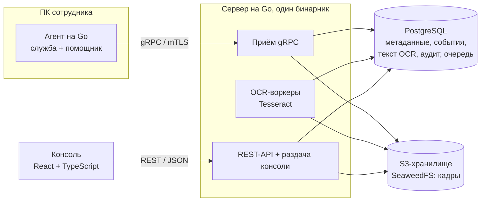

Эта страница — короткий ввод для разработчика: из чего состоит система, на чём написана и в каком порядке собирается. Подробности — в [Стеке](stack.html), [Архитектуре](architecture.html) и [Техническом задании](tz.html).

## Три части

- **Агент** (Go) — служба и помощник на ПК сотрудника: снимки по расписанию и событиям, процессы, входы, USB, выбранные ключи реестра, трей и окно «Что обо мне собирается». Отдаёт данные только своему серверу.
- **Сервер** (Go) — один модульный монолит: приём потока от агентов, воркеры OCR, REST-API для консоли, раздача статики консоли. Хранит метаданные и события в PostgreSQL, кадры — в S3-хранилище.
- **Консоль** (React + TypeScript) — веб-интерфейс для руководителя, ИБ, аудитора и владельца системы. Собирается в статику и раздаётся тем же сервером.

## Схема



## Стек

| Часть | Технология |
|---|---|
| Агент | Go, `golang.org/x/sys/windows`, захват DXGI Desktop Duplication, трей на Go |
| Сервер | Go, модульный монолит; gRPC-приём, REST-API, раздача консоли |
| OCR | Tesseract (`rus+eng`) в воркере сервера |
| Консоль | React + TypeScript + Vite + shadcn/ui |
| Данные | PostgreSQL (метаданные, события по дням, полнотекст OCR через `tsvector`/`pg_trgm`, аудит, очередь) |
| Снимки | S3-совместимое хранилище SeaweedFS (или локальный диск через тот же интерфейс) |
| Транспорт | gRPC/mTLS агент→сервер, REST/JSON консоль→сервер |
| Деплой | `docker compose` (сервер + PostgreSQL + SeaweedFS); агент — MSI через GPO |

## Репозиторий

Один монорепозиторий, по папке на часть:

```text
yasnost/
├── agent/      # Go: служба, помощник, захват, трей
├── server/     # Go: приём, OCR-воркеры, API, раздача консоли
├── console/    # React + TypeScript: веб-консоль
├── proto/      # .proto-контракты агент↔сервер, генерация grpc-go
└── deploy/     # docker compose, MSI-сборка агента, примеры политик
```

## Порядок разработки

По [вехам](milestones.html): сначала контракт и каркас, затем сквозной поток, затем разбор и консоль.

1. `proto/` — контракт агент↔сервер; каркасы `agent/`, `server/`, `console/`.
2. Сквозной путь: агент делает снимок → gRPC → сервер → S3 + запись в PostgreSQL.
3. Телеметрия (процессы, входы, USB, реестр) и политики.
4. OCR-воркеры и полнотекстовый поиск в PostgreSQL.
5. Консоль: лента дня, отчёты, расследования, поиск, аудит.
6. Деплой через `docker compose`, сборка MSI, раскатка кольцами.
