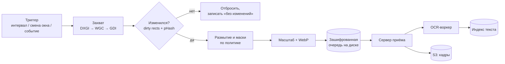
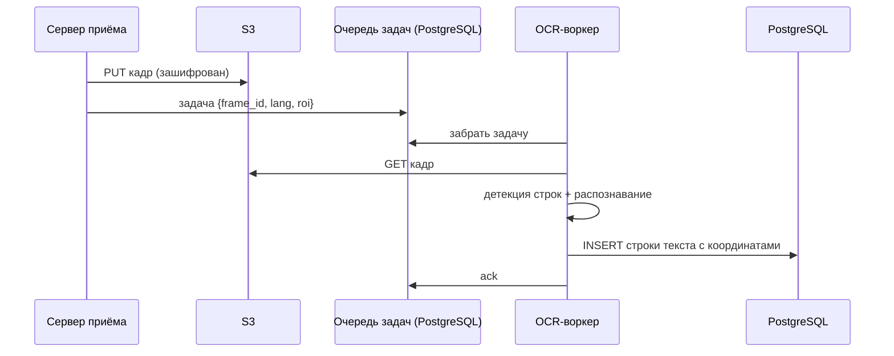

Эта страница описывает путь кадра от монитора до поиска в консоли. Требования к нему в формате ТЗ — в разделах [Агент](agent.html), [Политики](policy.html) и [Производительность](performance.html).

## Путь кадра

## Когда делается снимок

| Триггер | Пример | По умолчанию |
|---|---|---|
| Интервал | Раз в 5 минут | включён, 300 с |
| Смена активного окна | Переключились из Excel в браузер | включён, не чаще раза в 20 с |
| Запуск приложения из списка | Открыли банк-клиент — снимка нет, только событие | по политике |
| Событие безопасности | Подключили USB-накопитель, запустили запрещённое ПО | включён |
| Возврат из простоя | Пользователь вернулся после 10+ минут | включён |

Снимки **не делаются**: на экране блокировки и в защищённом рабочем столе (UAC, Ctrl+Alt+Del — помощнику они недоступны по устройству Windows), во время паузы, если её разрешает политика, вне рабочего графика и при простое: если ввода нет дольше порога, интервальные снимки прекращаются.

## Методы захвата

Агент использует абстракцию «источник кадра» с тремя реализациями и выбирает первую работающую. Выбор кэшируется на монитор и пересматривается после ошибки.

### 1. DXGI Desktop Duplication — основной

Доступен с Windows 8. Отдаёт кадр монитора прямо из видеопамяти и, что важно для нас, **список изменённых прямоугольников** с прошлого кадра. Если изменений нет, кадр не нужно ни копировать, ни сжимать.

Нюансы, которые нужно обработать:

- `DXGI_ERROR_ACCESS_LOST` при смене режима экрана, переходе в полноэкранное приложение или на защищённый рабочий стол — пересоздать дубликатор.
- На ноутбуках с двумя видеокартами дубликатор создаётся на адаптере, к которому подключён выход, иначе вызов вернёт ошибку.
- Курсор приходит отдельно; на снимок его дорисовываем сами.
- Защищённый контент (DRM-видео) приходит чёрным — это нормально.

### 2. Windows.Graphics.Capture — для окон и как запасной

С Windows 10 версии 1803. Умеет снимать конкретное окно, а не весь монитор, корректно работает с DPI и HDR. Используем для режима «снимок только активного окна» и как запасной путь, если DXGI не работает (например, в некоторых виртуальных средах). При захвате WGC система рисует жёлтую рамку вокруг области; на Windows 11 её можно отключить свойством `IsBorderRequired` после запроса доступа. Для открытого мониторинга рамка не проблема, но её нужно упомянуть в памятке для сотрудников.

### 3. GDI BitBlt, если первые два не сработали

Работает везде, включая старые RDP-сценарии, но медленнее и может не видеть аппаратно ускоренный контент. Включается, только если два других метода отказали.

### Несколько мониторов и DPI

Каждый монитор снимается отдельно и хранится как отдельный кадр с координатами в виртуальном рабочем столе. Помощник объявлен как Per-Monitor DPI Aware v2, иначе координаты окон и размеры кадров разъедутся на мониторах с разным масштабом.

### RDP и терминальные серверы

На терминальном сервере на каждую пользовательскую сессию запускается свой помощник; служба одна. Захват идёт внутри сессии, DXGI в RDP-сессии может быть недоступен, тогда работает WGC или GDI. Лицензирование и нагрузку на терминальные серверы закладываем отдельно ([Производительность](performance.html)).

## Размытие и исключения

Исключения применяются **на агенте, до сжатия**, поэтому исходный кадр с чувствительным окном не попадает ни на диск, ни в сеть.

| Правило | Как работает |
|---|---|
| Не снимать | Если активно окно из списка (по имени процесса, классу окна, заголовку или домену в браузере), кадр не делается, пишется только событие «исключено политикой» |
| Размыть окно | Прямоугольник окна из списка размывается гауссом с большим радиусом (текст нечитаем), остальной экран сохраняется |
| Размыть всё, кроме активного окна | Для политики «нужен контекст работы, а не соседние окна» |
| Только активное окно | Захват через WGC одного окна |

Домены в браузере определяем по заголовку окна и, для поддерживаемых браузеров, через UI Automation (адресная строка). Расширения для браузера в первой версии не делаем.

## Сжатие и дедупликация

### Масштаб

Кадр масштабируется так, чтобы длинная сторона была не больше 1920 пикселей (настраивается в политике). Для 4K-мониторов это вчетверо уменьшает объём при сохранении читаемости текста для OCR.

### Формат

| Формат | Размер кадра 1080p, офисный экран | Скорость кодирования | Решение |
|---|---|---|---|
| PNG | 0,5–2 МБ | быстро | только для отладки |
| JPEG q75 | 150–300 КБ | очень быстро | не берём: артефакты вокруг текста мешают OCR |
| **WebP q65–75** | 60–200 КБ | быстро | **по умолчанию** |
| AVIF | на 20–40% меньше WebP | в разы медленнее | опция для слабых каналов |

Размеры — оценка по типичным офисным экранам, точные цифры снимаем на фазе 0 ([Дорожная карта](roadmap.html)).

### Отбрасывание повторов

Два уровня проверки:

1. **Изменённые области DXGI.** Если с прошлого снимка ничего не менялось, кадр даже не копируется из видеопамяти.
2. **Перцептивный хэш.** Для кадра считается 64-битный dHash или pHash по уменьшенной копии. Если расстояние Хэмминга до прошлого отправленного кадра меньше порога (начальное значение 5, подбираем на пилоте), кадр не отправляется, а в событиях пишется ссылка на предыдущий.

Ожидаем, что в офисной работе отбрасывается 30–60% интервальных кадров. Это гипотеза, её проверяем на пилоте.

## OCR на сервере

- **Движок:** Tesseract 5 с языками `rus+eng` через cgo-обёртку, запускается воркером-горутиной внутри Go-сервера. Параметры (режим страницы, предобработка) подбираем на фазе 0 по точности на наших скриншотах.
- **Что распознаём:** только кадры, прошедшие дедупликацию. Если политика включает «только активное окно», распознаём только его область.
- **Нагрузка (оценка):** 500 ПК × 12 кадров в час × 50% после дедупликации = около 3000 кадров в час, меньше одного кадра в секунду. Это укладывается в один воркер на CPU с 8 ядрами; GPU нужен с парка от нескольких тысяч ПК.
- **Хранение текста:** строки с координатами в PostgreSQL (`ocr_lines`, партиции по дням), поиск по `tsvector` с русской морфологией («договор» находит «договора») и по `pg_trgm` для подстрок. Отдельный поисковый движок не нужен.
- **Поиск с подсветкой области:** координаты строк позволяют не только найти кадр, но и подсветить рамкой сам фрагмент текста на снимке и прыгнуть к моменту записи в плеере (FR-11, FR-12). Это принцип из патента Teramind US 10,853,508 B2 — индексировать видимый на экране текст и искать по нему с подсветкой области; реализуем свою версию (PostgreSQL + координаты строк), их код и движок не используем.
- **Оповещения по тексту — только с обоснованием.** Правило «на экране виден текст…» (OCR-alert) включается не галочкой: как и `ocr.region: full`, оно требует поля `justification` в политике и второй подписи владельца системы при публикации. Поиск по тексту всегда пишется в аудит — что искали, кто и когда.
- **Чувствительные данные:** после распознавания текст прогоняется через маскировщик (номера карт, паспортов, СНИЛС по шаблонам) — совпадения в индексе заменяются маской, исходный кадр остаётся под ролевым доступом.

## Офлайн-OCR на агенте

Опционально, для филиалов со слабым каналом: агент распознаёт текст через Windows.Media.Ocr (встроен в Windows 10+, нужен языковой пакет) и отправляет только текст и миниатюру, а полные кадры догружаются ночью или при подключении к офисной сети. Сервер не может запросить кадр с агента — канал только от агента к серверу. По умолчанию выключено.
