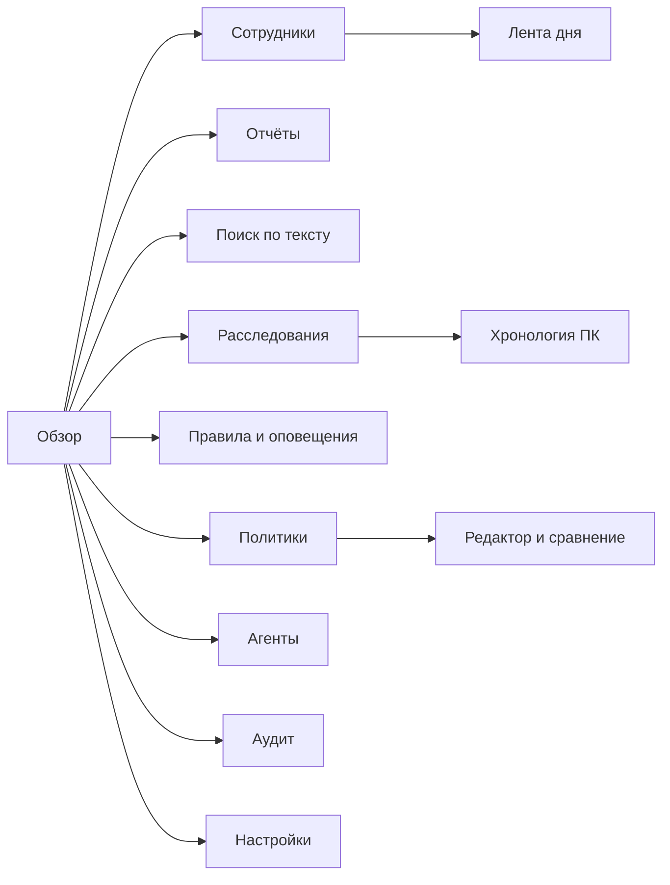

Консоль — одностраничное приложение на TypeScript и React, раздаётся сервером API. Интерфейс плотный, рабочий: таблицы, фильтры, ленты времени. Тёмная и светлая темы, клавиатурная навигация, ширина от 1280 пикселей как основная, от 390 — для просмотра оповещений и ленты с телефона.

## Принципы интерфейса

- **Нет рейтингов людей.** Сравнения — человека с ним же в прошлом и подразделения с подразделением. Никаких «топ-10 бездельников».
- **Кадр — по запросу.** В ленте по умолчанию миниатюры размыты; чтобы открыть кадр, нужно указать причину. Это не неудобство, а защита: просмотр снимков должен быть осознанным действием.
- **Пустота — это данные.** Пауза, нерабочее время, простой и отсутствие связи показываются разными цветами и подписями, а не одним серым «нет данных».
- **Ссылки на всё.** У каждого экрана с фильтрами есть адрес, который можно отправить коллеге (и который проверит его права).

## Карта экранов

## Экраны

### Обзор

Для руководителя — его подразделение, для ИБ и администратора — организация.

- Сводка дня: активное время, простой, паузы — по подразделению, без разбивки по людям.
- Свежие оповещения правил с переходом в расследование.
- Здоровье парка: агенты без связи больше суток, устаревшие версии, отказы захвата.
- Пустое состояние для нового развёртывания: шаги «установить агент → назначить политику → отметить ознакомление».

### Сотрудники и лента дня

Список с поиском и фильтрами по подразделению. Карточка сотрудника открывает **ленту дня**:

- Горизонтальная шкала рабочего дня: сегменты приложений, цвет по категории, отдельные цвета для простоя, паузы, нерабочего времени, отсутствия связи.
- Под шкалой — таблица сегментов: время, приложение, заголовок окна, домен, количество кадров.
- Миниатюры кадров в местах шкалы; клик → диалог с полем причины → кадр.
- Переключение дней клавишами `←` / `→`, сравнение с прошлой неделей.

Состояния: загрузка (скелет шкалы), нет ознакомления («Сотрудник не ознакомлен с положением, данные не собираются»), нет данных за день, ошибка API с повтором.

### Отчёты

| Отчёт | Что показывает | Выгрузка |
|---|---|---|
| Время в приложениях | По группе и периоду, с категориями | CSV, XLSX |
| Табель | Начало, конец, активное время по дням | XLSX, формат для 1С:ЗУП |
| Загрузка подразделения | Распределение активного времени, переработки | XLSX |
| Инвентаризация ПО | Программы, версии, число установок, последние запуски | CSV |
| Инвентаризация железа | ПК, CPU, память, диски, ОС, состояние защиты | CSV |
| USB и носители | Подключения по ПК и людям | CSV |

### Поиск по тексту

Только для ИБ. Строка поиска с подсказками операторов (`"точная фраза"`, `-исключить`, `person:`, `app:`, `date:`). Результаты — строки текста с подсветкой, миниатюрой (размытой) и временем; группировка по сотруднику и дню. Каждый поисковый запрос пишется в аудит.

### Расследования и хронология ПК

Расследование — папка с причиной, ответственным, сроком и списком людей и ПК. Внутри — **хронология**: единая лента событий ПК (входы, процессы, USB, сеть, изменения реестра, кадры) с фильтрами по типу. Из расследования ставится юридическое удержание данных.

### Правила и оповещения {#pravila-i-opoveshcheniia}

Конструктор правил: условие (тип события + фильтры), окно времени, порог, действие (оповещение в консоли, почта, SIEM, вебхук). Примеры из коробки:

- Запуск программы из списка запрещённых.
- Подключение USB-накопителя, не входящего в белый список.
- Активность вне рабочего графика дольше 30 минут.
- Агент остановлен или удалён.
- Помощник завершался больше трёх раз за день.

### Политики

Список политик с назначениями и версиями. Редактор — YAML с подсветкой и проверкой схемы на лету, справа — «как это увидит сотрудник» (текст для окна сотрудника, собранный из политики). Сравнение версий построчно. Публикация — кнопкой с обязательным комментарием; для чувствительных изменений — вторая подпись владельца системы.

### Агенты

Таблица ПК: имя, пользователь, версия агента, кольцо обновлений, последняя связь, размер очереди, метод захвата, ошибки. Массовые действия: перевести в кольцо, вывести из эксплуатации, отозвать сертификат.

### Аудит

Только для аудитора и владельца системы. Таблица: время, кто, роль, действие, объект, причина, IP. Фильтры, выгрузка, проверка целостности цепочки хэшей с результатом «цепочка цела / нарушена с записи N».

### Настройки

Интеграции (AD, SIEM, почта, SSO), реестр целей обработки и сроков хранения, категории приложений, производственный календарь, ключи и сертификаты (только просмотр отпечатков и сроков).

## Требования к вёрстке

| ID | Требование |
|---|---|
| UI-01 | Таблицы виртуализированы, 10 000 строк прокручиваются без подтормаживания |
| UI-02 | Лента дня рисуется меньше чем за 300 мс после ответа API на типичном ноутбуке |
| UI-03 | Все действия доступны с клавиатуры, фокус видимый, контраст текста по WCAG 2.2 AA |
| UI-04 | Анимации короткие и отключаются при `prefers-reduced-motion` |
| UI-05 | Пустые, загрузочные и ошибочные состояния есть у каждого экрана |
| UI-06 | Даты и время — в часовом поясе пользователя консоли с подписью зоны |
| UI-07 | Миниатюры кадров до указания причины показываются размытыми |
