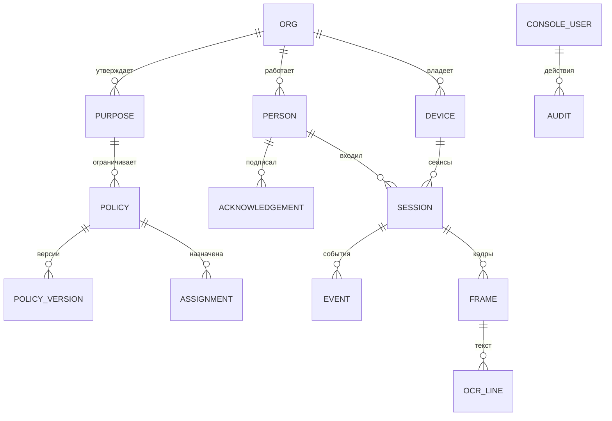

## Где что хранится

| Данные | Хранилище | Почему |
|---|---|---|
| Организации, ПК, учётные записи, группы, политики, цели обработки, ознакомления, роли | PostgreSQL | Мало строк, связи, транзакции |
| Журнал аудита консоли | PostgreSQL (append-only таблица) + копия в SIEM | Неизменяемость, юридическая значимость |
| События телеметрии | PostgreSQL `events` (партиции по дням) | Много строк, только добавление, агрегаты |
| Метаданные кадров | PostgreSQL `frames` (партиции по дням) | Связь с событиями по времени |
| Текст OCR | PostgreSQL `ocr_lines` (полнотекст `tsvector`/`pg_trgm`) | Поиск и фильтрация по времени и ПК |
| Кадры и миниатюры | S3 | Большие бинарные объекты, жизненный цикл |

## Связи между сущностями



## PostgreSQL

```sql schema/postgres.sql
create table org (
  id          uuid primary key,
  name        text not null,
  created_at  timestamptz not null default now()
);

create table purpose (                       -- цель обработки из приказа
  id            uuid primary key,
  org_id        uuid not null references org(id),
  code          text not null,               -- worktime-and-apps, incident-investigation
  title         text not null,
  legal_basis   text not null,               -- ссылка на ЛНА: номер и дата приказа
  collectors    text[] not null,             -- разрешённые сборщики
  max_retention jsonb not null,              -- {"screenshots":"90d","events":"365d"}
  approved_at   date not null,
  unique (org_id, code)
);

create table device (
  id            uuid primary key,
  org_id        uuid not null references org(id),
  hostname      text not null,
  ad_object_sid text,
  os_version    text,
  agent_version text,
  cert_serial   text unique,
  cert_expires  timestamptz,
  last_seen_at  timestamptz,
  status        text not null default 'active'   -- active | retired | quarantined
);

create table person (
  id          uuid primary key,
  org_id      uuid not null references org(id),
  ad_sid      text unique,
  login       text not null,
  full_name   text not null,
  department  text,
  manager_id  uuid references person(id)
);

create table acknowledgement (               -- ознакомление с ЛНА под подпись
  person_id   uuid not null references person(id),
  document    text not null,                 -- «Положение о мониторинге, ред. 1»
  signed_at   date not null,
  evidence    text not null,                 -- номер листа ознакомления / ID в СЭД
  recorded_by uuid not null,
  primary key (person_id, document)
);

create table policy (
  id          uuid primary key,
  org_id      uuid not null references org(id),
  purpose_id  uuid not null references purpose(id),
  name        text not null,
  unique (org_id, name)
);

create table policy_version (
  policy_id   uuid not null references policy(id),
  version     int  not null,
  body        jsonb not null,                -- нормализованный YAML
  sha256      bytea not null,
  signature   bytea not null,                -- Ed25519
  published_by uuid not null,
  published_at timestamptz not null default now(),
  justification text,
  primary key (policy_id, version)
);

create table assignment (
  policy_id   uuid not null references policy(id),
  target_kind text not null,                 -- org | group | device | person
  target_id   text not null,
  priority    int  not null default 0,
  primary key (policy_id, target_kind, target_id)
);

create table audit (                         -- журнал действий в консоли
  id          bigserial primary key,
  at          timestamptz not null default now(),
  actor_id    uuid not null,
  actor_role  text not null,
  action      text not null,                 -- frame.view, policy.publish, export.create
  object      text not null,                 -- frame:..., person:...
  reason      text,                          -- обязательна для frame.view
  ip          inet,
  prev_hash   bytea not null,                -- цепочка хэшей
  hash        bytea not null
);
revoke update, delete on audit from public;
```

## События, кадры и текст OCR в PostgreSQL

Эти таблицы растут быстрее справочников, поэтому партиционируются по дням (`PARTITION BY RANGE (ts)`): старые партиции удаляются целиком по сроку хранения, без построчной чистки. Поиск по тексту OCR — через `tsvector` с индексом GIN (морфология) и `pg_trgm` (подстроки).

```sql schema/events.sql
CREATE TABLE events (
    org_id      uuid        not null,
    device_id   uuid        not null,
    person_id   uuid,                       -- NULL до ознакомления: только техданные
    session_id  uuid        not null,
    seq         bigint      not null,       -- монотонный номер от агента
    ts          timestamptz not null,
    kind        text        not null,       -- foreground, idle_start, proc_start, usb_insert ...
    process     text,
    title       text,
    domain      text,
    attrs       jsonb       not null default '{}',
    retention   text        not null        -- events | security | inventory
) PARTITION BY RANGE (ts);
CREATE INDEX ON events (org_id, device_id, ts);

CREATE TABLE frames (
    org_id    uuid        not null,
    device_id uuid        not null,
    person_id uuid        not null,
    frame_id  uuid        not null,
    ts        timestamptz not null,
    trigger   text        not null,         -- interval, window_switch, usb, idle_return
    monitor   smallint,
    width     int, height int, bytes int,
    dhash     bigint,
    blurred   boolean     not null,         -- были ли зоны размытия
    s3_key    text        not null
) PARTITION BY RANGE (ts);
CREATE INDEX ON frames (org_id, person_id, ts);

CREATE TABLE ocr_lines (
    org_id    uuid        not null,
    person_id uuid        not null,
    frame_id  uuid        not null,
    ts        timestamptz not null,
    text      text        not null,         -- уже после маскирования
    bbox      int[]       not null,         -- x, y, w, h
    conf      real,
    tsv       tsvector generated always as (to_tsvector('russian', text)) stored
) PARTITION BY RANGE (ts);
CREATE INDEX ON ocr_lines USING gin (tsv);
CREATE INDEX ON ocr_lines USING gin (text gin_trgm_ops);
CREATE INDEX ON ocr_lines (org_id, person_id, ts);
```

Партиции на день создаёт планировщик (`pg_partman` или cron); дневная партиция старше `purpose.max_retention` дропается целиком.

## Как кадры лежат в S3

```text
s3://yasnost-frames/
  {org_id}/{yyyy}/{mm}/{dd}/{device_id}/{frame_id}.webp      # кадр, SSE с ключом тенанта
  {org_id}/{yyyy}/{mm}/{dd}/{device_id}/{frame_id}.thumb.webp # миниатюра 320px
```

Префикс по дате позволяет удалять данные правилом жизненного цикла бакета, не перебирая объекты. Доступ к объекту консоль получает только через подписанную ссылку со сроком 60 секунд, выдаваемую после проверки роли и записи в аудит.

## Сроки хранения {#sroki-khraneniia}

| Класс | По умолчанию | Основание выбора срока |
|---|---|---|
| Кадры и текст OCR | 90 дней | Достаточно для разбора инцидентов и трудовых споров по текущему кварталу; дольше — только по отдельному решению |
| События активности | 1 год | Годовые отчёты по загрузке и табелю |
| События безопасности (USB, входы, автозагрузка) | 1 год | Расследования, требования ИБ |
| Инвентаризация ПО и железа | 3 года | Учёт лицензий |
| Журнал аудита консоли | 5 лет | Доказательство правомерности доступа |
| Данные уволенного сотрудника | удаление через 30 дней после увольнения, кроме данных под юридическим удержанием | Цель обработки достигнута (ч. 7 ст. 5 152-ФЗ) |

Все сроки — предложение. Окончательные значения утверждаются приказом с участием юриста ([Открытые вопросы](questions.html)).

**Юридическое удержание.** Специалист ИБ может поставить удержание на данные конкретного человека за период (например, на время служебной проверки). Записи под удержанием копируются в таблицы `*_hold` и бакет без жизненного цикла, удержание требует причины и пишется в аудит; срок удержания ограничен 180 днями с продлением.
