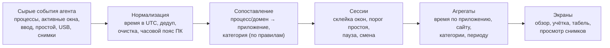

Цифры в консоли — не «чёрный ящик». Они собираются из сырых событий агента понятным конвейером: каждый шаг можно объяснить, а правила распознавания видны и редактируются. Единого «балла продуктивности» нет.

## Что присылает агент

Агент на ПК фиксирует события и отправляет их на сервер исходящим соединением (портов не слушает). В сыром потоке:

- **Процессы** — запуск и остановка: имя файла (`exe`), полный путь, PID, издатель (цифровая подпись).
- **Активные окна** — смена переднего окна: заголовок, процесс, время. Для браузера — домен из заголовка или адреса.
- **Ввод** — есть ли активность клавиатуры и мыши, поминутно (без перехвата нажатий).
- **Простой** — отсутствие ввода.
- **USB** — подключение и отключение носителей (VID/PID).
- **Снимки экрана** — раз в 10 минут и по событиям (смена окна, возврат из простоя, USB).

Агент хранит очередь локально: если связи нет, данные не теряются и досылаются позже.

## Нормализация

Сервер приводит события к единому виду: время — к UTC с учётом часового пояса ПК, повторы и обрывы — к одному событию, обрезанные заголовки — к полному, где возможно. Персональные данные в тексте снимков (номера карт, паспортов, СНИЛС) маскируются до индексации.

## Сопоставление: процесс → приложение и категория

Главный шаг — понять, **что за программа** работала. Это делают правила сопоставления (видны и редактируются в консоли, раздел «Правила → Распознавание»). Правило — это условие по имени процесса, издателю, пути или домену окна → приложение, тип (программа или сайт) и категория.

| Условие | Распознаётся как | Категория |
|---|---|---|
| `1cv8.exe`, издатель «1С-Софт» | 1С:Предприятие | рабочее |
| `EXCEL.EXE` / `WINWORD.EXE`, издатель Microsoft | Excel / Word | рабочее |
| `OUTLOOK.EXE`, издатель Microsoft | Почта | рабочее |
| `chrome.exe` + домен `crm.corp.local` | CRM | рабочее |
| `chrome.exe` + домен `tasks.corp.local` | Портал задач | рабочее |
| `chrome.exe` + домен `disk.yandex.ru` | Облачный диск | непрофильное |
| `Telegram.exe`, издатель «Telegram FZ-LLC» | Мессенджер | нейтральное |
| `explorer.exe`, издатель Microsoft | Проводник | нейтральное |

Для браузера приложение определяется по **домену** из заголовка окна: один `chrome.exe` даёт и «CRM», и «Портал задач», и «Облачный диск» — это разные приложения-сайты с разными категориями. Если ни одно правило не подошло — приложение помечается «Прочее», категория «нейтральное», пока администратор не добавит правило.

Категории — **рабочее**, **нейтральное**, **непрофильное** — задаются правилами и меняются вживую: изменил категорию в «Правилах» — цифры в обзоре, учётках и табеле пересчитались. Это оценка приложения, а не человека: рейтинги сотрудников система не строит.

## Сессии и пороги простоя

Из потока активных окон собираются сессии:

- Подряд идущие интервалы одного приложения **склеиваются** в одну сессию.
- Минута считается **активной**, если в ней был ввод; иначе — **простой**.
- Простой короче **5 минут** остаётся внутри сессии (отошёл на минуту — не разрыв). Простой дольше порога — отдельный отрезок «простой».
- **Пауза** — сотрудник сам отметил перерыв; это не простой и не рабочее время, показывается штриховкой.
- **Вне графика** — время за пределами рабочего дня сотрудника из AD.

## Агрегаты и табель

По сессиям считается время **по приложению, сайту, категории и периоду** (день, неделя, месяц). Табель — производная: рабочее время за период из активных минут, с вычетом пауз и простоя. Выгрузка — в XLSX или в формате для 1С:ЗУП; каждая выгрузка пишется в журнал аудита.

Важно: демо-консоль строит все эти цифры **из сырых событий этим же конвейером** — обзор, учётка, просмотр снимков и табель согласованы между собой, потому что считаются из одного источника.

## Пограничные случаи

| Случай | Как обрабатывается |
|---|---|
| **Несколько мониторов** | активное окно одно на сеанс; снимок делается с монитора активного окна, помечается его номер |
| **Терминальный сервер (RDS/VDI)** | события и сессии разделяются по сеансам пользователей, не смешиваются между людьми |
| **Экран заблокирован** | ввода нет → простой; снимки не делаются |
| **Фоновая музыка или видео** | звук не считается активностью; активна та программа, что в переднем окне с вводом |
| **Приватные и скрытые окна** | окна из списка размытия (мессенджеры, банк-клиент, личная почта) размываются ещё на ПК; на сервер попадает размытый кадр, заголовок скрыт |
| **Нераспознанный процесс** | «Прочее», категория «нейтральное», до добавления правила |
| **Нет связи с сервером** | события копятся в очереди на ПК и досылаются; в агрегатах появляются после синхронизации |

Подробнее о ролях и о том, кто какие данные видит, — в разделе [«Роли и права»](roles.html); о том, что собирается, а что нет, — в разделе [«Приватность»](privacy.html).
