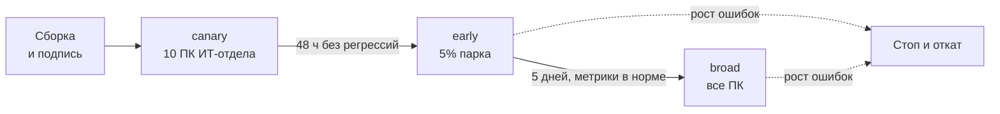

Сервер поднимается в контуре организации, агент раскатывается на ПК централизованно. Отдельно к каждому компьютеру ходить не нужно.

## Сервер

Базовая поставка — `docker compose` для небольших установок; для крупных есть Helm-чарт для Kubernetes. В составе: шлюз приёма, API, OCR-воркеры, PostgreSQL и S3-хранилище.

```yaml deploy/compose.yaml (сокращённо)
services:
  gateway:
    image: registry.corp.local/yasnost/gateway:1.0.0
    ports: ["8443:8443"]
    environment:
      YASNOST_PG_DSN: postgres://yasnost@pg/yasnost
      YASNOST_S3_ENDPOINT: http://s3:8333
  api:
    image: registry.corp.local/yasnost/api:1.0.0
    environment:
      YASNOST_OIDC_ISSUER: https://sso.corp.local/realms/corp
  worker-ocr:
    image: registry.corp.local/yasnost/worker-ocr:1.0.0
  pg: { image: postgres:17 }
  s3: { image: chrislusf/seaweedfs, command: ["server", "-s3"] }
```

Для установок до 200 ПК хватает одной виртуальной машины: все сервисы в Compose, PostgreSQL и локальный диск вместо кластера.

## Агент: пакет MSI

Один MSI для x64 со службой, помощником, окном сотрудника и обновлятором. Параметры задаются при установке:

| Свойство MSI | Обязательно | Пример | Назначение |
|---|---|---|---|
| `SERVER` | да | `yasnost.corp.local:8443` | адрес шлюза приёма |
| `INSTALL_TOKEN` | да | `grp_sales_7f3c…` | токен регистрации (групповой, со сроком) |
| `CA_THUMBPRINT` | да | `3A9F…` | отпечаток корня УЦ для закрепления |
| `RING` | нет | `early` | кольцо обновлений: `canary`, `early`, `broad` |
| `PROXY` | нет | `http://proxy.corp.local:3128` | явный прокси |

```powershell Тихая установка
msiexec /i YasnostAgent-1.0.0-x64.msi /qn ^
  SERVER=yasnost.corp.local:8443 ^
  INSTALL_TOKEN=grp_sales_7f3c2b ^
  CA_THUMBPRINT=3A9F0C...E1 ^
  RING=broad
```

### Раскатка через групповые политики

1. Положите MSI в общую папку с правом чтения для «Компьютеры домена».
2. Создайте трансформацию `.mst` со свойствами `SERVER`, `INSTALL_TOKEN`, `CA_THUMBPRINT`.
3. В GPO: «Конфигурация компьютера → Политики → Установка программ» назначьте пакет с трансформацией.
4. Привяжите GPO к пилотному подразделению (OU), затем расширяйте на остальные.

Через SCCM/MECM — приложение с типом развёртывания MSI и той же командной строкой, раскатка по коллекциям-кольцам.

### Если антивирус блокирует агент

Агент не прячется и не обходит защиту. Если EDR блокирует захват экрана или ETW-сессию, добавьте исключение **по подписи издателя**, а не по пути:

| Что | Значение |
|---|---|
| Издатель | организация из сертификата подписи кода |
| Процессы | `YasnostAgent.exe`, `yasnost-session.exe`, `yasnost-ui.exe`, `yasnost-update.exe` |
| Каталоги | `%ProgramFiles%\Yasnost`, `%ProgramData%\Yasnost` |

## Обновления кольцами

Новая версия раскатывается по кольцам и останавливается сама, если в кольце растут ошибки.



Обновлятор ставит новую версию, запускает службу и ждёт от неё сигнал «здоров» 120 секунд. Нет сигнала — откат на предыдущую версию.

## Удаление

Удаление — через MSI с паролем или токеном из консоли. Перед удалением агент отправляет событие и остаток очереди. После удаления на ПК не остаётся ни данных, ни ключей, ни журналов.

## Резервное копирование

| Что | Как | Частота |
|---|---|---|
| PostgreSQL | архив WAL + полная копия | непрерывно + ежесуточно |
| Снимки (S3) | репликация на другой узел или площадку | непрерывно |
| Ключи УЦ и подписи | офлайн-носители в сейфе, два экземпляра | при изменении |
