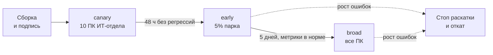

## Агент: пакет MSI

Один MSI для x64 со службой, помощником, окном сотрудника и обновлятором. Сборка — WiX Toolset из CI, подпись Authenticode ([Безопасность](security.html#podpis-koda-i-obnovlenii)).

| Свойство MSI | Обязательно | Пример | Назначение |
|---|---|---|---|
| `SERVER` | да | `rakurs.corp.local:8443` | Адрес шлюза приёма |
| `INSTALL_TOKEN` | да | `grp_sales_7f3c...` | Токен регистрации (групповой, со сроком) |
| `CA_THUMBPRINT` | да | `3A9F...` | Отпечаток корня УЦ Ракурса для закрепления |
| `RING` | нет | `early` | Кольцо обновлений: `canary`, `early`, `broad` |
| `PROXY` | нет | `http://proxy.corp.local:3128` | Явный прокси, если не подходит системный |
| `UNINSTALL_PASSWORD_HASH` | нет | `argon2id$...` | Защита от удаления без пароля |

```powershell Тихая установка вручную или из скрипта
msiexec /i RakursAgent-1.0.0-x64.msi /qn `
  SERVER=rakurs.corp.local:8443 `
  INSTALL_TOKEN=grp_sales_7f3c2b `
  CA_THUMBPRINT=3A9F0C...E1 `
  RING=broad `
  /l*v C:\Windows\Temp\rakurs-install.log
```

### Через групповые политики

1. Положите MSI в общую папку с правом чтения для «Компьютеры домена».
2. Создайте трансформацию `.mst` со свойствами `SERVER`, `INSTALL_TOKEN`, `CA_THUMBPRINT` (например, в Orca).
3. В GPO: «Конфигурация компьютера → Политики → Конфигурация программ → Установка программ» — назначьте пакет с трансформацией.
4. Привяжите GPO к OU пилотной группы, затем расширяйте.

### Через SCCM / MECM

Приложение с типом развёртывания MSI, командной строкой из примера выше, правилом обнаружения по коду продукта MSI и требованием «Windows 10 22H2 или новее, x64». Развёртывание — на коллекции по кольцам.

### Требования к ПК

- Windows 10 22H2 / Windows 11, x64.
- WebView2 Runtime (на Windows 11 встроен; на Windows 10 обычно уже установлен вместе с Edge). Без него не открывается только окно сотрудника; трей и сбор работают.
- Исходящий доступ к `SERVER` по TCP 8443.
- 500 МБ свободного места (2 ГБ под очередь берутся по возможности).

### Памятка для антивируса

Мы не просим исключать агент из проверки по умолчанию. Если EDR блокирует поведение (захват экрана, ETW-сессию), добавьте исключение **по подписи издателя**, а не по пути:

| Что | Значение |
|---|---|
| Издатель | Организация из сертификата подписи кода |
| Процессы | `RakursAgent.exe`, `rakurs-session.exe`, `rakurs-ui.exe`, `rakurs-update.exe` |
| Каталоги | `%ProgramFiles%\Rakurs`, `%ProgramData%\Rakurs` |
| Поведение | Захват экрана (DXGI/WGC), ETW-сессия `Rakurs-Kernel`, чтение реестра |

## Обновления



- Служба раз в 6 часов спрашивает `GetUpdate` для своего кольца. Манифест содержит версию, URL пакета, SHA-256 и подпись Ed25519 офлайн-ключом релизов.
- Пакет скачивается в `%ProgramData%\Rakurs\updates`, проверяются хэш, подпись манифеста и Authenticode пакета.
- `rakurs-update.exe` останавливает службу, ставит новую версию, запускает службу и ждёт от неё сигнал «здоров» 120 секунд. Нет сигнала — откат на предыдущую версию и событие `update_rolled_back`.
- Раскатка останавливается автоматически, если в кольце доля откатов или падений помощника выше порога (по умолчанию 2%).
- Минимальная поддерживаемая версия задаётся на сервере; устаревшие агенты получают `FAILED_PRECONDITION` и обновляются в первую очередь.

## Удаление

Удаление через MSI с паролем или токеном из консоли. Перед удалением служба отправляет событие `agent_uninstall` и остаток очереди (с таймаутом 60 с). После удаления на ПК не остаётся данных: очередь, ключи и журналы стираются.

## Сервер

Базовая поставка — Docker Compose для небольших инсталляций и Helm-чарт для Kubernetes.

```yaml deploy/compose.yaml (сокращённо)
services:
  gateway:
    image: registry.corp.local/rakurs/gateway:1.0.0
    ports: ["8443:8443"]
    environment:
      RAKURS_PG_DSN: postgres://rakurs@pg/rakurs
      RAKURS_CH_DSN: clickhouse://ch:9000/rakurs
      RAKURS_S3_ENDPOINT: http://s3:8333
      RAKURS_NATS_URL: nats://nats:4222
    secrets: [gateway_tls, ca_chain]
  api:
    image: registry.corp.local/rakurs/api:1.0.0
    environment:
      RAKURS_OIDC_ISSUER: https://sso.corp.local/realms/corp
  worker-ocr:
    image: registry.corp.local/rakurs/worker-ocr:1.0.0
    deploy: { replicas: 1 }
  pg:     { image: postgres:17 }
  ch:     { image: clickhouse/clickhouse-server:25.8 }
  nats:   { image: nats:2.11, command: ["-js"] }
  s3:     { image: chrislusf/seaweedfs, command: ["server", "-s3"] }
```

Версии образов в примере — ориентир; фиксируем конкретные теги при сборке поставки.

## Резервное копирование

| Что | Как | Частота |
|---|---|---|
| PostgreSQL | WAL-архив + полная копия (pgBackRest) | непрерывно + ежесуточно |
| ClickHouse | `BACKUP ... TO S3` в отдельный бакет | ежесуточно |
| S3 кадры | Репликация в другой узел или площадку | непрерывно |
| Ключи УЦ и подписи | Офлайн-носители в сейфе, два экземпляра | при изменении |
