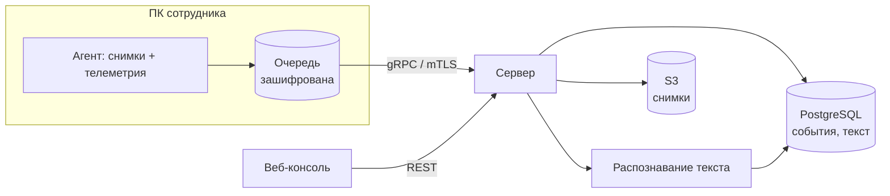

Данные идут в одну сторону: агент собирает их на ПК и отправляет серверу; сервер хранит и отдаёт в консоль. Сервер не выполняет команд на ПК сотрудника.

1. Агент делает снимок по расписанию или событию и собирает телеметрию активности.
2. Окна из списка исключений размываются или пропускаются **до сохранения** кадра; одинаковые кадры отбрасываются.
3. Данные копятся в зашифрованной очереди и уходят на сервер по gRPC с взаимной проверкой сертификатов (mTLS).
4. Сервер распознаёт текст на снимках, пишет события и текст в PostgreSQL, снимки — в S3.
5. Консоль показывает ленту дня, отчёты и результаты поиска; каждый просмотр снимка попадает в журнал аудита.
