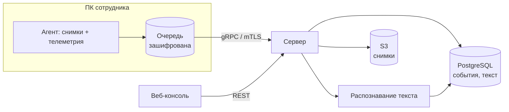
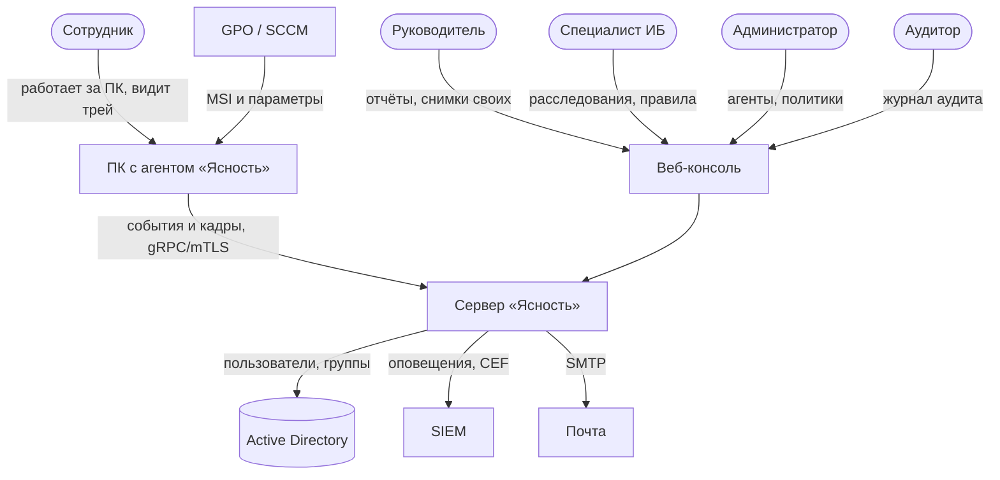
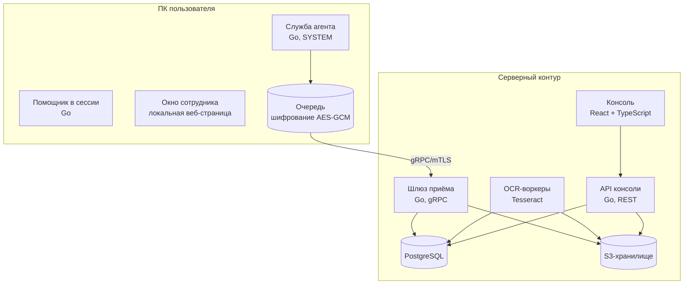
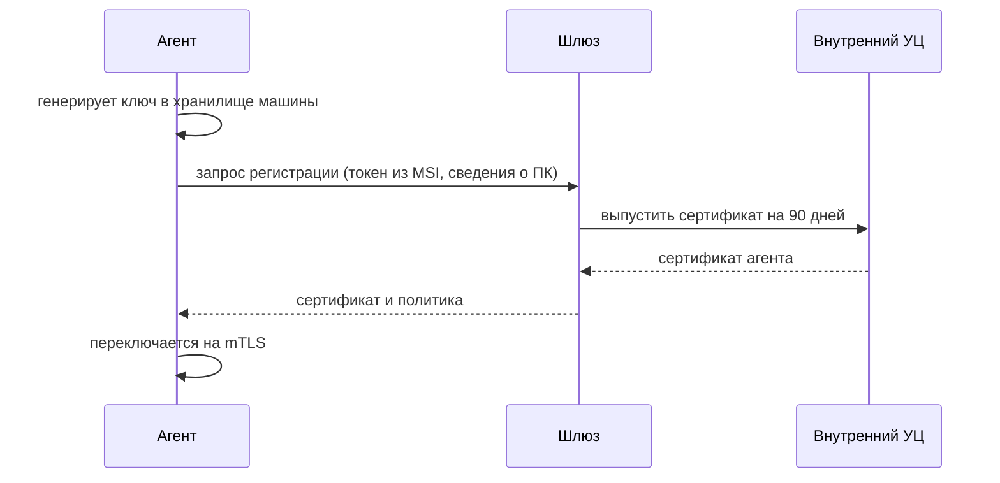

Данные идут в одну сторону: агент собирает их на ПК и отправляет серверу; сервер хранит и отдаёт в консоль. Сервер **не выполняет команд** на ПК сотрудника — только выдаёт подписанные политики и обновления.

## Путь данных

1. Агент делает снимок по расписанию или событию и собирает телеметрию активности.
2. Окна из списка исключений размываются или пропускаются **до сохранения** кадра; одинаковые кадры отбрасываются.
3. Данные копятся в зашифрованной очереди и уходят на сервер по gRPC с взаимной проверкой сертификатов (mTLS).
4. Сервер распознаёт текст на снимках, пишет события и текст в PostgreSQL, снимки — в S3.
5. Консоль показывает ленту дня, отчёты и результаты поиска; каждый просмотр снимка попадает в журнал аудита.

## Кто обращается к системе

Данные с рабочих ПК не выходят за контур компании. Наружу система обращается только к инфраструктуре организации: Active Directory, SIEM и почте.

## Из каких частей собрана система

Агент и сервер написаны на одном языке — Go; консоль — веб-приложение на React и TypeScript, его раздаёт сервер.

| Часть | Язык | За что отвечает |
|---|---|---|
| Служба агента | Go | Очередь, отправка, применение политики, обновления, системная телеметрия |
| Помощник в сессии | Go | Снимки, активное окно, простой, размытие, трей |
| Окно сотрудника | React | Перечень собираемых данных, последние снимки, пауза |
| Шлюз приёма | Go | Приём потоков от агентов, запись в PostgreSQL и S3 |
| API консоли | Go | REST, проверка прав, журнал аудита, выдача снимков |
| Воркеры | Go + Tesseract | OCR, маскирование, правила, удаление по сроку |
| Консоль | React, TypeScript | Интерфейс для всех ролей |

## Как агент подключается к серверу

При установке агент генерирует ключ и запрашивает сертификат, предъявляя одноразовый токен из MSI. После регистрации он работает только по своему сертификату — пароли на ПК не хранятся.

## Принципы

- **Данные идут в одну сторону.** Агент сам инициирует все соединения; на ПК нет открытых портов.
- **Сервер не командует агентом.** Только подписанные политики и обновления.
- **Снимки отдельно от событий.** Событие ссылается на снимок по идентификатору; доступ к снимку проверяется отдельно и пишется в аудит.
- **Сроки хранения заложены в данные.** У каждой записи есть класс хранения, по которому её удаляет фоновая очистка.
