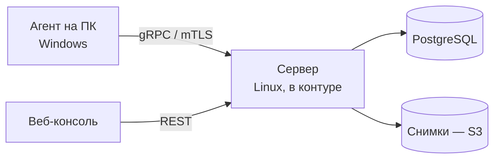

**«Ясность»** — система открытого мониторинга активности на рабочих компьютерах организации. Разворачивается в контуре компании (не в облаке). Этот документ — краткое описание ПО для заказчика: назначение, состав, функции, примеры и условия развёртывания.

## Назначение

- учёт фактически отработанного за компьютером времени (ст. 91 ТК РФ);
- анализ использования приложений и загрузки подразделений;
- инвентаризация программного и аппаратного обеспечения;
- сбор данных для расследования инцидентов информационной безопасности.

Система **не предназначена** для скрытого наблюдения, перехвата переписки и ввода с клавиатуры, оценки сотрудников одним числом «продуктивности».

## Состав системы

- **Агент** — служба и помощник на ПК сотрудника (Windows): снимки экрана, телеметрия, значок в трее и окно «Что обо мне собирается».
- **Сервер** — в контуре организации (Linux, контейнеры): приём данных, распознавание текста, хранение, API и раздача консоли.
- **Веб-консоль** — интерфейс для администратора, руководителя, ИБ и аудитора.
- **Хранилище** — PostgreSQL (метаданные, события, текст) и S3-совместимое хранилище снимков.

## Границы версии 1.0

| Входит | Не входит в 1.0 |
|---|---|
| Агент для Windows 10 (22H2) и 11, x64; Windows Server 2019/2022 с RDS | macOS, мобильные устройства |
| Сервер на Linux (контейнеры) в контуре организации | Облачная SaaS-версия |
| Веб-консоль для администраторов, руководителей, ИБ, аудитора | Мобильное приложение консоли |
| Окно сотрудника на ПК | Онлайн-трансляция экрана |
| OCR и поиск по тексту на снимках | Блокировка приложений и сайтов |
| Интеграция с Active Directory и SIEM | Интеграция с DLP-шлюзами (после 1.0) |
| — | Агент для Linux (Astra, РЕД ОС) — версия 1.1 |

Вне объёма этого описания: сравнение с конкурентами, маркетинг, дорожная карта, разбор архитектурных решений и внутреннего протокола.
