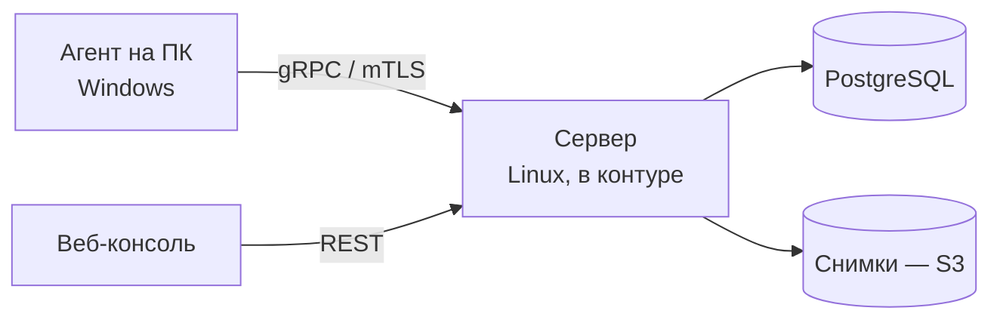

**«Ясность»** — система открытого мониторинга активности на рабочих компьютерах организации. Она разворачивается в контуре компании, а не в облаке: данные не покидают вашу инфраструктуру. Этот документ — описание ПО для заказчика: назначение, состав, функции с примерами, схемы работы, требования и порядок развёртывания.

Мониторинг здесь **открытый**. Сотрудник знает, что система работает, видит её значок и в любой момент может посмотреть, что именно о нём собирается. Скрытого режима в продукте нет.

## Зачем это нужно

- учёт фактически отработанного за компьютером времени (ст. 91 ТК РФ);
- анализ использования приложений и загрузки подразделений;
- инвентаризация программного и аппаратного обеспечения;
- сбор данных для расследования инцидентов информационной безопасности.

Система **не предназначена** для скрытого наблюдения, перехвата переписки и ввода с клавиатуры и для оценки сотрудника одним числом «продуктивности».

## Из чего состоит

- **Агент** на ПК сотрудника (Windows): снимки экрана, телеметрия активности, значок в трее и окно «Что обо мне собирается».
- **Сервер** в контуре организации (Linux, контейнеры): приём данных, распознавание текста, хранение, API и раздача консоли.
- **Веб-консоль** — рабочее место администратора, руководителя, специалиста ИБ и аудитора.
- **Хранилище** — PostgreSQL (метаданные, события, текст) и S3-совместимое хранилище снимков.

## Границы версии 1.0

| Входит | Не входит в 1.0 |
|---|---|
| Агент для Windows 10 (22H2) и 11, x64; Windows Server 2019/2022 с RDS | macOS, мобильные устройства |
| Сервер на Linux (контейнеры) в контуре организации | Облачная SaaS-версия |
| Веб-консоль для администраторов, руководителей, ИБ, аудитора | Мобильное приложение консоли |
| Окно сотрудника на ПК | Онлайн-трансляция экрана |
| OCR и поиск по тексту на снимках | Блокировка приложений и сайтов |
| Интеграция с Active Directory и SIEM | Интеграция с DLP-шлюзами (после 1.0) |
| — | Агент для Linux (Astra, РЕД ОС) — версия 1.1 |

## Куда смотреть дальше

- [Роли и доступ](roles.html) — кто что видит в системе и матрица прав.
- [Функции](functions.html) — что умеет система, по каждому требованию пример и границы.
- [Как это работает](how.html) — путь данных от ПК до отчёта и схемы системы.
- [Примеры](examples.html) — политика сбора, запись события, экраны и отчёты консоли.
- [Требования и стек](spec.html) и [Развёртывание](deploy.html) — что нужно для установки и как её провести.
- [Приватность и аудит](privacy.html) — что собирается, что нет, сроки хранения и журнал действий.
- [Вопросы заказчика](faq.html) — короткие ответы на частые вопросы.
