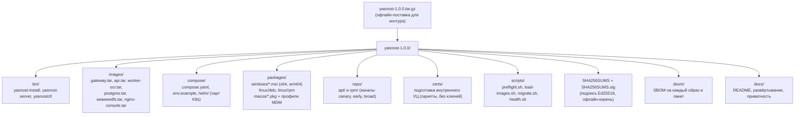
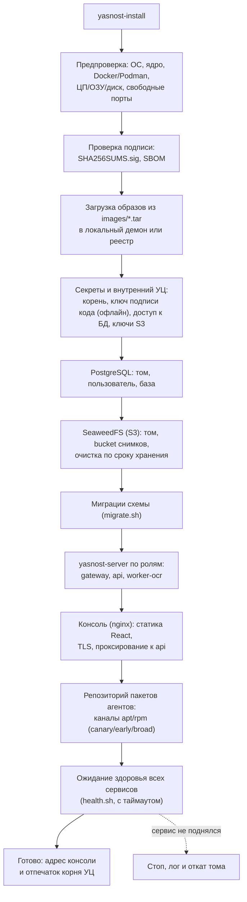
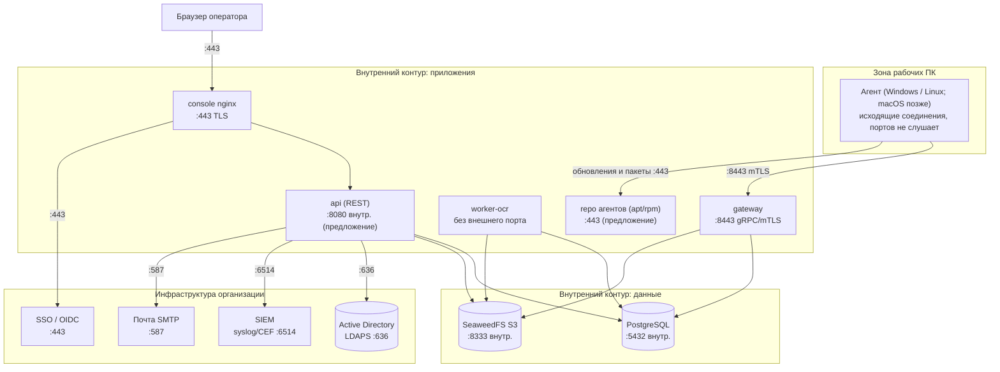
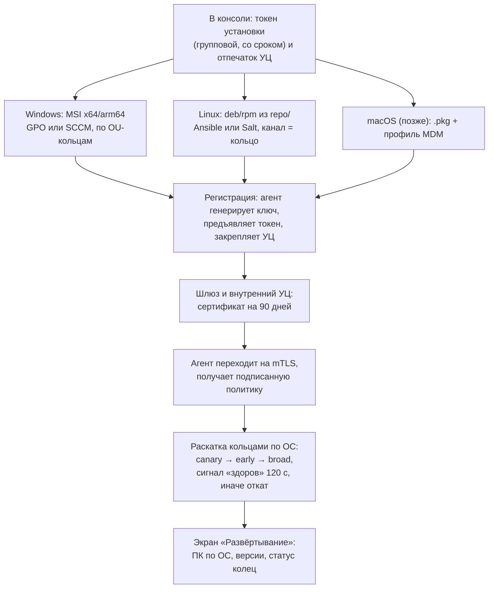

Сервер «Ясность» разворачивается в закрытом контуре из одного офлайн-архива — доступ в интернет не нужен. Ниже — что лежит в архиве, в каком порядке идёт установка и какие сервисы работают после неё. Графический мастер установки описан отдельно, на странице [«Установщик»](installer.html).

!!! note "Имена и порты"
    Часть имён файлов и внутренних портов ещё не закреплена в документации продукта. Такие значения ниже помечены как **предложение** — их уточняют на этапе разработки.

## Что в архиве поставки

Образы мультиархитектурные (amd64 и arm64), совместимы с Docker и Podman для закрытого контура.

## Порядок установки

`yasnost-install` проходит шаги по очереди и останавливается, если шаг не прошёл: ничего «наполовину» не остаётся.

На выходе установщик показывает адрес консоли и отпечаток корня внутреннего УЦ — его сверяют на агентах при подключении.

## Сервисы, порты и зоны сети

После установки части системы работают в трёх зонах. Агент на ПК портов не слушает — он сам открывает исходящее соединение к шлюзу.

| Зона | Сервис | Порт | Откуда значение |
|---|---|---|---|
| Рабочие ПК | агент | только исходящие соединения | from `how.md` |
| Приложения | gateway (gRPC/mTLS) | 8443 | from `deploy.md` |
| Приложения | api (REST) | 8080, внутр. | предложение |
| Приложения | консоль (nginx) | 443 | предложение |
| Приложения | worker-ocr | без внешнего порта | — |
| Приложения | репозиторий агентов | 443 | предложение |
| Данные | PostgreSQL | 5432, внутр. | обычный порт |
| Данные | SeaweedFS S3 | 8333, внутр. | значение SeaweedFS по умолчанию |
| Инфраструктура | Active Directory | LDAPS 636 | обычный порт |
| Инфраструктура | SSO / OIDC | 443 | обычный порт |
| Инфраструктура | SIEM | syslog/CEF 6514 | предложение |
| Инфраструктура | Почта | SMTP 587 | обычный порт |

Наружу из контура система обращается только к Active Directory, SSO, SIEM и почте организации.

## Раскатка агентов

Агент не нужно ставить руками на каждый ПК. Из консоли берут токен установки (групповой, со сроком) и отпечаток УЦ, а дальше раскатывают средствами организации — по кольцам обновлений, отдельно для каждой ОС.

Подробнее про кольца, поддержку ОС и порядок выпуска — на странице [«Платформы и план выпуска»](platforms.html). Про централизованную раскатку через GPO/SCCM и Ansible/Salt — в разделе [«Развёртывание»](deploy.html).
