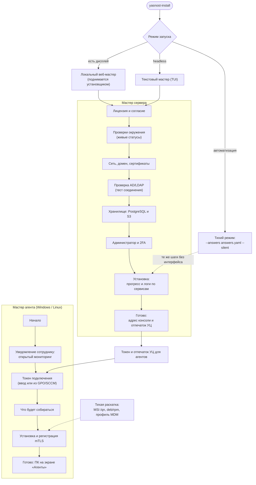

У «Ясности» свой установщик — и для сервера, и для агента. Он проводит по шагам, показывает живые статусы проверок и говорит человеческим языком, что произойдёт. Для массовой раскатки остаётся тихий режим без интерфейса. Общая логика установки и схемы — на странице [«Установка»](install.html).

## Как это выглядит

Мастер сделан в той же палитре и с тем же знаком «Зрачок», что консоль: слева — шаги со статусами, справа — текущий шаг, снизу — «Назад» и «Далее».

<figure class="shot">
<picture>
  <source media="(prefers-color-scheme: dark)" srcset="assets/img/installer-server-preflight-dark.png">
  
</picture>
<figcaption>Мастер сервера: предпроверки с живыми статусами. Прототип интерфейса.</figcaption>
</figure>

<figure class="shot">

<figcaption>Мастер агента: шаг уведомления сотрудника — открытый мониторинг виден до установки. Прототип интерфейса.</figcaption>
</figure>

## Поток установщика

## Мастер сервера

| Шаг | Что делает |
|---|---|
| Лицензия | текст соглашения и согласие на установку |
| Проверки окружения | ОС, Docker/Podman, ЦП/ОЗУ/диск, свободные порты — с живыми статусами |
| Сеть, домен, сертификаты | имя консоли, выпуск внутреннего УЦ или загрузка сертификата организации |
| Проверка AD/LDAP | тест соединения с каталогом, предпросмотр найденных подразделений |
| Хранилище | тома и настройки PostgreSQL и S3, срок хранения снимков |
| Администратор и 2FA | первый администратор и обязательный второй фактор |
| Установка | прогресс и логи по каждому сервису |
| Готово | адрес консоли и отпечаток корня УЦ |

Для серверов без графики тот же мастер работает текстом (TUI). Для автоматизации — тихий режим с файлом ответов, шаги те же.

## Установщик агента

Брендированный установщик на рабочем ПК показывает сотруднику, что мониторинг открытый, **до** установки: шаг «Уведомление сотруднику» и перечень того, что будет собираться (и что не собирается никогда). Токен подключения вводится вручную или подставляется автоматически из GPO/SCCM. Для массовой раскатки остаётся тихий режим: `msiexec /i yasnost-agent.msi /qn`, пакеты deb/rpm из репозитория каналов, профиль MDM.

## Выбор технологий

| Решение | Почему так |
|---|---|
| Мастер сервера — локальный веб-интерфейс, который поднимает `yasnost-install` | тот же стек, что у консоли (React); работает по сети на сервере без графической оболочки; для headless есть текстовый режим |
| Текстовый мастер (TUI) как запасной путь | серверы в контуре часто без рабочего стола; установку надо довести до конца по SSH |
| Тихий режим с файлом ответов | те же шаги без интерфейса — для разворачивания из скрипта и повторяемых установок |
| Окно установщика агента на Windows — на Wails v3 (как окно сотрудника), запасной вариант — бутстраппер WiX | один тот же подход к интерфейсу, что у окна «Что обо мне собирается»; единый брендовый вид |
| Тихий MSI/deb/rpm остаётся основным для массовой раскатки | установка на сотни ПК идёт через GPO/SCCM и Ansible/Salt без участия человека |

Выбор Wails v3 и наличие запасного браузерного пути для окна сотрудника — проектное решение из плана кроссплатформенной работы; оно же переиспользуется в установщике агента.
