Сроки — оценка для команды из двух Go-разработчиков на агент, двух на сервер и консоль и одного человека на QA и развёртывание, при условии, что юридическая подготовка идёт параллельно. Детальные вехи с критериями завершения — в разделе [Этапы и сроки](milestones.html).

```mermaid Фазы проекта, недели от старта
gantt
    dateFormat  X
    axisFormat  %s
    section Фаза 0
    Прототип захвата и телеметрии     :p0, 0, 4
    section Фаза 1
    MVP агента и сервера               :p1, 4, 14
    section Фаза 2
    Пилот на 30–50 ПК                 :p2, 14, 20
    section Фаза 3
    OCR, правила, отчёты               :p3, 16, 26
    section Фаза 4
    Тираж на весь парк                 :p4, 26, 34
    section Параллельно
    ЛНА, уведомления, 152-ФЗ           :legal, 0, 14
```

## Фаза 0. Прототип (4 недели)

Цель — снять технические риски до того, как строить систему.

- Go-прототип помощника: захват через DXGI Desktop Duplication на 3–4 конфигурациях (один монитор, два монитора с разным DPI, RDP-сессия, ноутбук с гибридной графикой).
- Замер размера кадра в WebP и AVIF, точность перцептивного хэша на реальной работе.
- Перечень процессов, окна, idle, реестр, один ETW-провайдер.
- Замер CPU и памяти. **Решение «идём дальше / меняем стек»** по итогам.

## Фаза 1. MVP (10 недель)

- Служба и помощник, установка MSI, обновление.
- gRPC-протокол с mTLS, локальная очередь, повторная отправка.
- Сервер приёма (Go, модульный монолит), PostgreSQL, S3-хранилище.
- Консоль: список ПК, лента дня, просмотр снимков, редактор политик, журнал аудита.
- Окно сотрудника «Что обо мне собирается».

## Фаза 2. Пилот (6 недель)

- 30–50 ПК в 2–3 отделах, добровольцы плюс одно подразделение целиком.
- Замер нагрузки, объёма данных, отказов захвата.
- Опрос участников: понятно ли, что собирается, мешает ли агент.
- Корректировка политик по умолчанию и бюджетов.

## Фаза 3. Аналитика (10 недель)

- OCR-конвейер на сервере, полнотекстовый поиск по снимкам с подсветкой области на кадре.
- Правила и оповещения (запрещённое ПО, USB, нерабочее время), пороги частоты и эскалация уровня.
- **Прозрачный риск по правилам:** счётчик «срабатывания × вес правила» с видимыми в политике весами. Никакого единого балла человека и никакого чёрного ящика.
- Отчёты: время в приложениях, табель, инвентаризация ПО, хронология инцидента.
- Интеграции: Active Directory, SIEM (syslog/CEF), выгрузка в 1С:ЗУП как вариант.

Сравнение с базовой линией человека или отдела (аномалии) — **не в первой версии**: только после пилота, только как уведомление, с раскрытием в положении и без автоматических действий. Подробно разобрано в [Сравнении: Teramind](teramind.html).

## Фаза 4. Тираж (8 недель)

- Раскатка кольцами: 5% → 25% → 100% парка.
- Мониторинг здоровья агентов, SLA на сервер, резервное копирование.
- Агент для Linux (Astra, РЕД ОС) — отдельной веткой после стабилизации Windows.

## Что не входит в первую версию

- macOS и мобильные устройства.
- Онлайн-трансляция экрана (live view) — сознательно откладываем, это самая «слежечная» функция; решение после пилота.
- Блокировка приложений и сайтов, редирект, удалённое управление и выполнение команд на ПК — это задача EDR и прокси, а не мониторинга.
- Скрытый режим, кейлоггер, динамика набора и мыши как биометрия — запрещены по принципу, не «отложены» (см. [Закон и этика](legal.html) и [Сравнение: Teramind](teramind.html)).
- Оценка «продуктивности» одним числом.
- Отдельная аналитическая СУБД (ClickHouse) — вернёмся к ней, только если флот превысит несколько тысяч ПК и PostgreSQL перестанет держать аналитику по событиям.
