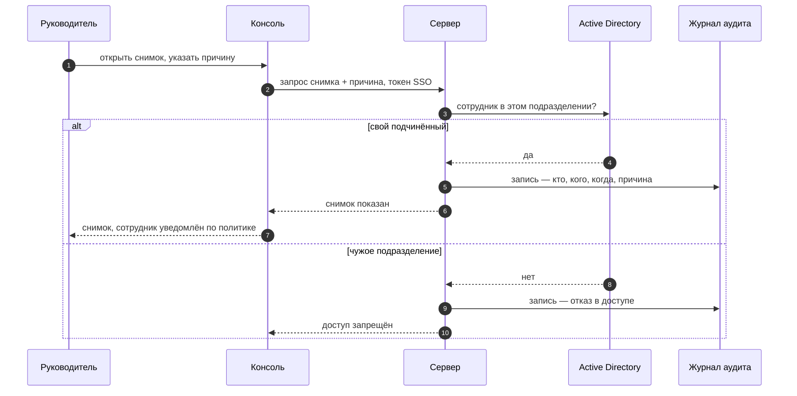

Доступ к данным разграничен по ролям. Роли берутся из групп Active Directory; вход в консоль — только через корпоративный SSO с двухфакторной аутентификацией. Каждый просмотр снимка экрана фиксируется в неизменяемом журнале аудита.

## Кто работает в системе

| Роль | Что делает в системе |
|---|---|
| Владелец системы | Утверждает политики и состав собираемых данных, отвечает перед руководством |
| Администратор системы | Развёртывание, агенты, интеграции; **без доступа к снимкам** по умолчанию |
| Специалист ИБ | Расследования, правила, доступ к снимкам с указанием причины |
| Руководитель подразделения | Отчёты, лента дня и снимки сотрудников своего подразделения; каждый просмотр снимка — в журнале аудита, сотрудник уведомляется по политике |
| HR | Отмечает ознакомление сотрудника с положением о мониторинге |
| Аудитор | Только чтение журнала аудита, без доступа к данным сотрудников |
| Сотрудник | Видит свои данные и перечень того, что собирается |

Разделение «кто управляет системой» и «кто смотрит данные» — базовая защита от злоупотреблений: администратор разворачивает агенты и настраивает интеграции, но снимки по умолчанию ему недоступны.

## Матрица прав

| Действие | Админ | ИБ | Руководитель | HR | Владелец | Аудитор | Сотрудник |
|---|---|---|---|---|---|---|---|
| Управление агентами | да | — | — | — | да | — | — |
| Черновик политики | да | да | — | — | да | — | — |
| Публикация политики | — | — | — | — | да | — | — |
| Отчёты по подразделению | — | да | своё | — | да | — | — |
| Лента дня сотрудника | — | да | своё подразделение | — | да | — | своя |
| Просмотр снимков | — | да, с причиной | своё подразделение, с причиной | — | да, с причиной | — | свои |
| Поиск по тексту | — | да | — | — | — | — | — |
| Отметка ознакомления | — | — | — | да | да | — | — |
| Выгрузка данных сотрудника | — | — | — | — | да | — | запрос |
| Журнал аудита | — | — | — | — | да | да | — |

Руководитель видит ленту дня и снимки только тех, кто входит в его подразделение по данным AD (поле `manager` и подразделение OU). Сотрудники других подразделений ему недоступны, и это проверяется на сервере при каждом запросе, а не только в интерфейсе.

## Как проверяется доступ к снимку

Снимок открывается с указанием причины. Сервер при каждом запросе сверяет подразделение с Active Directory, пишет и успех, и отказ в журнал аудита и, если это включено политикой, уведомляет сотрудника о просмотре.

