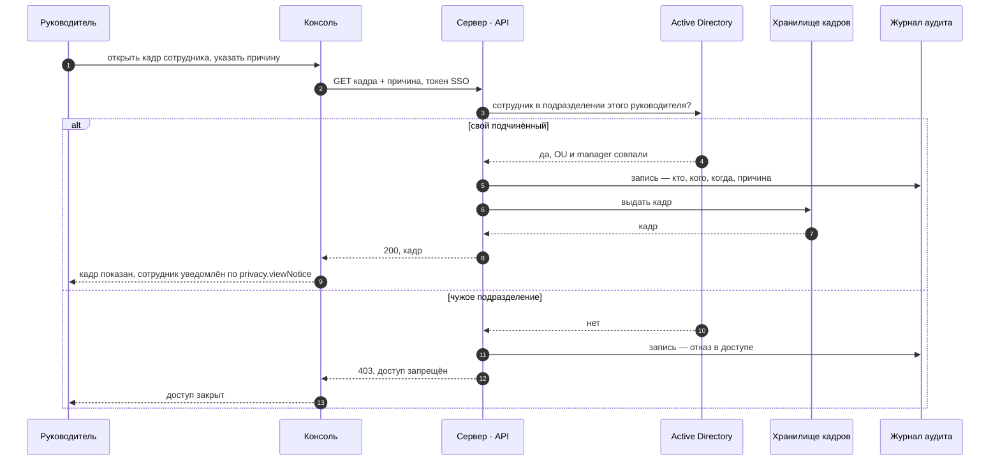

«Ясность» хранит одни из самых чувствительных данных в компании. Поэтому каждое требование безопасности здесь проверяемое и имеет номер `SEC-xx`.

## Модель угроз

| Угроза | Пример | Мера |
|---|---|---|
| Злоупотребление доступом изнутри | Руководитель смотрит снимки сотрудника из любопытства | Доступ только к своему подразделению, причина просмотра, аудит, уведомление сотрудника о просмотрах по политике |
| Компрометация сервера | Атакующий получил доступ к API | Нет команд агентам ([ADR-006](adr.html#adr-006)), кадры зашифрованы ключом из отдельного хранилища, сегментация сети |
| Подмена агента или обновления | Злоумышленник подсовывает свой бинарник | Подпись Authenticode, проверка подписи службой, манифест обновления подписан офлайн-ключом |
| Подмена сервера | Агент отправляет данные на чужой хост | mTLS с закреплённым корневым сертификатом своего УЦ |
| Кража данных с ПК | Похищен ноутбук с очередью | AES-256-GCM, ключ под DPAPI машины, плюс BitLocker как требование к ПК |
| Перехват трафика | Прокси или злоумышленник в сети | TLS 1.3, отказ от соединения при подмене сертификата |
| Отказ в обслуживании | Агент или атакующий забивает сервер | Лимиты на агента, обратное давление, квоты организации |
| Обход пользователем | Пользователь останавливает агент | ACL службы, перезапуск, события о вмешательстве ([Агент](agent.html#zashchita-ot-vmeshatelstva)) |

## PKI и mTLS

- Собственный двухуровневый УЦ: корневой ключ офлайн, промежуточный — на сервере в HSM или в Vault (Transit).
- Сертификат агента — ECDSA P-256, срок 90 дней, автоматическое продление за 30 дней до конца (`RenewCertificate`). Закрытый ключ создаётся на ПК в хранилище машины с запретом экспорта; при наличии TPM — в TPM через Microsoft Platform Crypto Provider.
- Отзыв: список отозванных серийных номеров проверяет шлюз при каждом подключении; вывод ПК из эксплуатации в консоли отзывает сертификат сразу.
- Сертификат сервера выпускается тем же УЦ; агент доверяет только своему корню, системное хранилище сертификатов не используется.

## Подпись кода и обновлений

| Что | Чем подписано | Где проверяется |
|---|---|---|
| Бинарники агента, MSI | Authenticode (сертификат подписи кода организации) + метка времени | Windows при запуске, служба при старте, EDR |
| Манифест обновления | Ed25519, офлайн-ключ релизов | Служба перед загрузкой и перед установкой |
| Политика | Ed25519, ключ сервиса политик | Служба при получении |

!!! warning "Сертификат подписи кода: решить до фазы 1"
    Получение сертификата Authenticode от публичного УЦ для российской организации может быть затруднено. Варианты: сертификат через партнёра в доступной юрисдикции; подпись внутренним корпоративным УЦ с распространением доверия через GPO (работает только внутри домена). Решение нужно принять до фазы 1 — см. [Открытые вопросы](questions.html).

## Шифрование

| Где | Как |
|---|---|
| На ПК | Очередь — AES-256-GCM, ключ данных под DPAPI машины; кадры удаляются после подтверждения сервером |
| В сети | TLS 1.3, только AEAD-шифры |
| S3 | Шифрование на стороне сервера с ключом тенанта; ключи в Vault, ротация раз в год |
| PostgreSQL | Шифрование дисков (LUKS) на узлах; резервные копии шифруются отдельным ключом |
| Резервные копии | Шифруются, хранятся отдельно, проверка восстановления раз в квартал |

## Ролевой доступ {#rbac}

| Действие | Админ | ИБ | Руководитель | HR | Владелец | Аудитор | Сотрудник |
|---|---|---|---|---|---|---|---|
| Управление агентами | да | — | — | — | да | — | — |
| Черновик политики | да | да | — | — | да | — | — |
| Публикация политики | — | — | — | — | да | — | — |
| Отчёты по подразделению | — | да | своё | — | да | — | — |
| Лента дня сотрудника | — | да | своё подразделение | — | да | — | своя |
| Просмотр кадров | — | да, с причиной | своё подразделение, с причиной | — | да, с причиной | — | свои |
| Поиск по тексту | — | да | — | — | — | — | — |
| Ознакомления | — | — | — | да | да | — | — |
| Выгрузка данных сотрудника | — | — | — | — | да | — | запрос |
| Журнал аудита | — | — | — | — | да | да | — |

Роли берутся из групп AD; вход в консоль — только через корпоративный SSO с двухфакторной аутентификацией. Администратор системы по умолчанию не видит кадры: разделение «кто управляет системой» и «кто смотрит данные» — базовая защита от злоупотреблений.

Руководитель подразделения видит ленту дня и кадры только тех, кто входит в его подразделение по данным AD (поле `manager` и OU). Сотрудники других подразделений, в том числе соседних, ему недоступны: сервер проверяет это на каждый запрос, а не только в интерфейсе. Каждый просмотр кадра руководителем пишется в журнал аудита с причиной, сотрудник получает уведомление о просмотре, если это включено в политике (`privacy.viewNotice`).

## Как проверяется доступ к кадру {#rbac-flow}

Доступ решается на сервере при каждом запросе, а не в интерфейсе. Подразделение берётся из AD (поле `manager` и OU), любой отказ и любой успешный просмотр попадают в журнал аудита.

## Аудит действий администраторов {#audit}

- Пишется **каждое** действие с персональными данными: просмотр ленты, открытие кадра, поиск, выгрузка, изменение политики, отметка ознакомления, удержание.
- Таблица только на добавление: у роли приложения нет прав `UPDATE` и `DELETE`. Каждая запись содержит хэш предыдущей; разрыв цепочки обнаруживается проверкой в консоли.
- Копия журнала в реальном времени уходит в SIEM, куда у администраторов «Ясности» нет доступа на запись.
- Сотрудник может запросить, кто и когда смотрел его данные (через владельца системы или в окне агента, если это включено).

## Защита персональных данных по требованиям ФСТЭК

Если система обрабатывает персональные данные сотрудников, она становится информационной системой персональных данных. Уровень защищённости определяется по постановлению Правительства № 1119, состав мер — по приказу ФСТЭК № 21. Конкретный уровень и необходимость сертифицированных средств защиты определяет служба ИБ и юрист организации; в ТЗ закладываем меры, которые не зависят от уровня: идентификация и аутентификация, управление доступом, регистрация событий, защита каналов и носителей, контроль целостности.

## Требования к разработке

| ID | Требование |
|---|---|
| SEC-01 | Зависимости проверяются в CI: `govulncheck` и проверка модулей для Go, аудит npm для консоли, сканирование образов контейнеров |
| SEC-02 | Для каждой сборки формируется SBOM (CycloneDX) |
| SEC-03 | `unsafe`-код в агенте только в модулях обёрток WinAPI, каждый блок с комментарием-обоснованием и ревью двумя людьми |
| SEC-04 | Воспроизводимые сборки агента, подпись только на выделенном сборочном узле |
| SEC-05 | Секреты не в репозитории; ключи подписи — в HSM или офлайн |
| SEC-06 | Внешний пентест перед тиражом (фаза 4) и после крупных изменений протокола |
| SEC-07 | Фаззинг разбора политик и сообщений протокола (`cargo fuzz`, `go test -fuzz`) |
